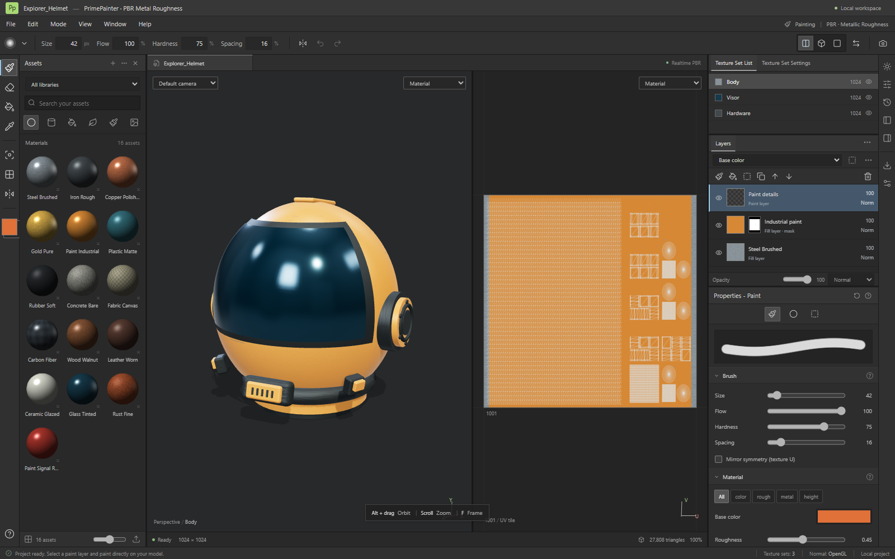

# PrimePainter

An experimental, local PBR texture painter for Windows and the browser. Paint directly on a 3D model or its UV layout, work with layers and masks, and export texture maps for a game engine.

**Version 0.1.1.** PrimePainter is an independent implementation inspired by the layout and workflows of Adobe Substance 3D Painter. It implements a working painting core; substantial advanced functionality is still missing. It does not read Substance projects or require an Adobe account.



## What works

- Interactive 3D and 2D painting, split view, orbit/pan/zoom, camera presets, wireframe and channel inspection.
- Brush size, flow, hardness and spacing; eraser; material picker; texture-U mirror symmetry. Pointer pressure affects size and flow, though physical tablets have not been validated.
- Polygon fill by triangle, UV island, mesh element or texture set in both views.
- Paint and fill layers, grayscale masks, visibility, opacity, ordering, duplication and supported merges. Four shared blend modes: Normal, Multiply, Screen and Overlay.
- Base Color, Roughness, Metallic and Height painting, with an OpenGL normal map derived from Height.
- Sixteen original procedural material presets, original demo meshes, asset search and bitmap import into a paint layer.
- OBJ and self-contained GLB/glTF import, with texture sets based on mesh materials.
- Editable `.prime` projects, undo/redo, a local recovery copy, native Windows file dialogs and browser downloads.
- PNG texture export in ZIP archives, with fixed PBR, Unity URP, Unity HDRP and Unreal packing templates. DirectX normal conversion is available on export.

No account or cloud service is required. The application uses TypeScript, Vite, Three.js and Electron.

## Run from source

Use **Node.js 22.12.0 or newer** and npm. Node 22 and 24 are the recommended development lines. The renderer requires a browser with WebGL 2 support and a working GPU driver. Windows is the validated desktop platform.

From the repository directory, install the locked dependencies:

```sh
npm ci
```

### Browser

```sh
npm run dev
```

Open the local URL printed by Vite. Projects and texture archives are saved through browser downloads; recovery data stays in that browser profile.

To build and preview the browser application:

```sh
npm run build
npm run preview
```

### Windows desktop

```sh
npm run desktop
```

This builds the application and opens its Electron window. Import, open and save use native Windows dialogs.

`Start PrimePainter.cmd` can also launch an existing portable executable or the local application. Use `npm run desktop` when you need to rebuild changed source files.

### Windows portable build

```sh
npm run package
```

Run packaging on Windows. The command builds the application and creates `release/PrimePainter-0.1.1.exe`, which can be run directly without installation. Generated packages are separate from the source tree.

## First painting session

1. Start with the Explorer Helmet demo, or create a project with `Ctrl+N`.
2. Use `Ctrl+I` to import a UV-mapped OBJ, GLB or self-contained glTF.
3. Select the texture set for the surface you want to paint, then select a paint layer. Drag with the left mouse button in either view.
4. Double-click a material asset to add a fill layer. To paint on a fill layer's mask, add a white or black mask and select its thumbnail.
5. Save the editable project with `Ctrl+S`. Export texture maps separately with `Ctrl+Shift+E`.

White mask pixels reveal a layer; black pixels hide it. Fill layers are procedural and receive brush strokes through their masks.

| Action | Shortcut |
| --- | --- |
| Paint / erase / polygon fill / picker | `1` / `2` / `4` / `P` |
| Orbit | `Alt` + left drag |
| Pan / zoom / frame | Right or middle drag / wheel / `F` |
| Split / 3D / 2D view | `F1` / `F2` / `F3` |
| Brush size | `[` / `]` |
| Mirror texture U / wireframe | `L` / `W` |
| Undo / redo | `Ctrl+Z` / `Ctrl+Y` |
| New / import mesh / open / save | `Ctrl+N` / `Ctrl+I` / `Ctrl+O` / `Ctrl+S` |
| Export textures | `Ctrl+Shift+E` |

Keyboard shortcuts use physical key codes and support the Russian keyboard layout. Custom shortcut editing is not implemented.

## Formats and limits

| Item | Current support |
| --- | --- |
| Mesh import | OBJ, GLB and self-contained glTF; up to 100 MiB and 2 million triangles |
| Project | `.prime`: JSON containing mesh, UVs, layer data, settings and embedded PNG maps; opening limit 220 MB |
| Bitmap import | PNG, JPEG and WebP, up to 32 MiB and 8192 × 8192; imported into Base Color |
| Working resolution | 256, 512, 1024 or 2048 square pixels, shared across texture sets |
| Texture export | 8-bit PNG maps in ZIP; five individual PBR maps or fixed engine packing templates |
| Project size | Up to 16 texture sets and 80 layers, subject to an estimated 768 MiB raster budget |
| Undo | Up to 16 actions; old canvases target 128 MiB while retaining at least one action; history is not saved in `.prime` |

The raster budget is not a total RAM or VRAM limit, and the listed maxima may not all be reachable together. A mesh without UVs can be viewed but cannot be painted. Imported material images are replaced by editable texture sets; skinned meshes are imported as static geometry.

Packed exports use white ambient occlusion because AO baking is not implemented. The HDRP detail mask is also white, and smoothness is `1 − roughness`. File packing is tested; importing the results into Unity or Unreal has not been validated in this project.

Important gaps include `.spp`/`.sbsar`, FBX/USD, UDIM, automatic UV unwrapping, seam padding, high-to-low baking, cage/skew tools, Smart Materials/Masks, anchors, filters, layer groups, paths/ribbons/particles, clone/smudge, Iray, emissive/opacity channels, HDR environment import, and 4K/8K working maps. The tinted-glass preset is opaque.

The [research notes](docs/recon.md) and [feature matrix](docs/features.csv) are currently written in Russian. They document the wider comparison, known limits and verification scope.

## Verification

Build before running tests: the native Electron workflow loads the production files in `dist`.

```sh
npm run build
npm test
```

The current test configuration targets Windows with Microsoft Edge installed. Playwright starts the local Vite server automatically.

Local verification for **0.1.1 passed 35 tests**: 14 engine, 7 viewport, 12 browser workflows, one keyboard-layout test and one production Electron workflow. The command also runs the desktop boundary self-check. This records a local result, not a hosted CI status.

Coverage includes channel pixels, compositing, masks, undo/redo, project roundtrips, malformed imports, UV selection, changed-channel uploads and packed exports. The automated native workflow uses real Electron and file operations while substituting dialog path results. Actual Windows import and save dialogs were also checked separately with Russian-layout shortcuts. Physical tablets and large production projects remain unvalidated.

For the local painting profiler, build first and run:

```sh
node tests/paint-profile.cjs
```

Performance results depend on the scene, resolution and hardware; see the research notes for the measured setup.

## Source map

| Path | Purpose |
| --- | --- |
| `src/main.ts` | Application UI, commands and project/file workflows |
| `src/engine.ts` | Canvas painting, PBR compositing, layers, masks and history |
| `src/viewport.ts` | Three.js rendering, UV picking and mesh import |
| `src/demo-model.ts` | Original procedural demo geometry and UV atlases |
| `src/shortcuts.ts` | Keyboard-layout handling |
| `electron/` | Isolated desktop bridge, native file operations and shell checks |
| `tests/` | Engine, viewport, browser and Electron regression tests |
| `docs/` | Research, feature tracking and screenshots |

## Contributing

Bug reports, focused fixes and reproducible test cases are welcome. Read [CONTRIBUTING.md](CONTRIBUTING.md) before opening a change.

## License

Released under the [MIT License](LICENSE). See [THIRD_PARTY_NOTICES.md](THIRD_PARTY_NOTICES.md) for third-party notices; dependencies retain their own licenses.

PrimePainter is not affiliated with or endorsed by Adobe. Adobe Substance 3D Painter is a product of Adobe.
